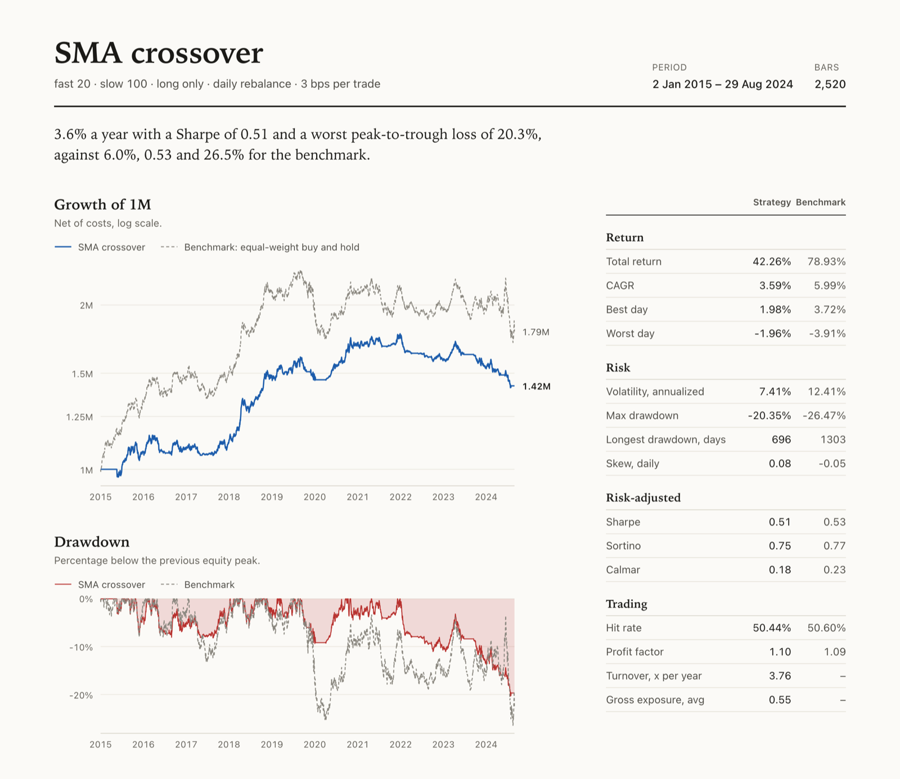
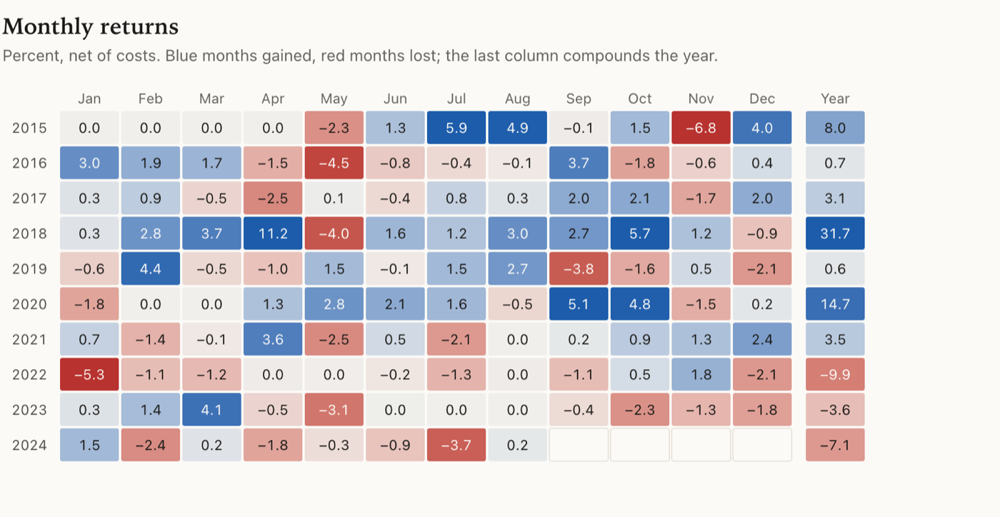

# quant-backtester

[](https://github.com/TheWingTheWong/quant-backtester/actions/workflows/ci.yml)

A vectorized backtesting engine for daily trading strategies, written in Python
with numpy and pandas. It simulates a portfolio that trades toward target
weights, accounts for weight drift between rebalances, charges commission,
slippage, borrow and financing, and reports the statistics a reviewer will ask
for: CAGR, volatility, Sharpe, Sortino, Calmar, drawdown depth and duration,
hit rate and turnover. A `qbt` command runs a backtest, a parameter grid or a
walk-forward study, and writes a one-file HTML tearsheet.

Everything runs offline. The default data source is a seeded synthetic market
(geometric Brownian motion with Markov regime switches), so every number in
this README can be reproduced with the commands next to it.



## Why another backtester

Most vectorized backtests are one line, `(weights.shift(1) * returns).sum(axis=1)`,
and that line quietly assumes the portfolio is rebalanced to target every day
at zero cost. This engine keeps the speed of the vectorized approach but does
the accounting properly:

- **Drift is real.** Between rebalances each position grows with its own
  returns, so a monthly-rebalanced 60/40 is not a daily-rebalanced 60/40.
- **Turnover is measured against drifted weights**, not against yesterday's
  targets, so costs are charged on what you would actually trade.
- **No look-ahead.** A signal computed at the close of bar `t` earns returns
  from bar `t + 1`. `--delay` pushes execution further out to test latency
  sensitivity. The test suite checks every strategy for leaks by comparing
  weights computed on full and truncated histories.
- **Verified against a loop.** The vectorized simulator matches a plain
  bar-by-bar reference implementation to 1e-12 for daily, weekly, monthly
  and fixed-interval rebalancing, with costs.

It is also quick. On an Apple Silicon laptop, simulating 50 assets over
20 years of daily bars takes about 10 ms, and a 229-combination SMA grid over
ten years of four assets finishes in about one second.

## Quickstart

Requires Python 3.10+ and [uv](https://docs.astral.sh/uv/).

```bash
git clone https://github.com/TheWingTheWong/quant-backtester.git
cd quant-backtester
uv sync
uv run qbt run --strategy sma --fast 20 --slow 100
```

Output:

```
SMA crossover  fast=20 slow=100 allow_short=False
Synthetic regime-switching GBM, seed 42: 4 assets, 2,520 bars (2015-01-02 to 2024-08-29)
rebalance D, delay 0, costs 1+2 bps per trade

Metric                  Strategy  Benchmark
----------------------  --------  ---------
Total return              42.26%     78.93%
CAGR                       3.59%      5.99%
Annualized vol             7.41%     12.41%
Sharpe                      0.51       0.53
Sortino                     0.75       0.77
Calmar                      0.18       0.23
Max drawdown             -20.35%    -26.47%
Max DD duration (days)       696       1303
Hit rate                  50.44%     50.60%
Turnover (x/yr)             3.76          -
Avg gross exposure          0.55          -

Tearsheet written to /path/to/quant-backtester/reports/sma.html
```

The benchmark is an equal-weight buy-and-hold of the same assets under the same
cost model. Here the crossover gives up 2.4 points of CAGR for a drawdown that
is 6 points shallower and roughly half the time underwater: a trend filter
mostly buys you lower exposure (0.55 on average), not alpha, on a market with
no built-in momentum.

## The tearsheet

`qbt run` writes `reports/<strategy>.html`. It is a single file with no
JavaScript and no network requests, so it can be emailed, attached to a pull
request or printed. It contains:

- growth of capital on a log scale, against the benchmark
- the drawdown (underwater) curve
- the statistics table, grouped into return, risk, risk-adjusted and trading
- a rolling 252-day Sharpe ratio
- a monthly returns grid with compounded yearly totals
- the five worst drawdowns with peak, trough, recovery date and length
- the run setup: data source, rebalance rule, execution delay and costs

Charts are inline SVG. Axis labels are HTML positioned over the drawing, so
text stays at reading size on a phone instead of shrinking with the chart. The
page follows the reader's light or dark preference and prints cleanly.



## CLI

```
qbt run          backtest one strategy and write a tearsheet
qbt grid         rank every combination of a parameter grid
qbt walkforward  walk-forward optimization, out-of-sample
qbt strategies   list strategies and their parameters
qbt data         export price data (e.g. synthetic) to CSV
```

### Strategies and their parameters

Strategy flags are generated from each strategy's parameters, so
`qbt run --strategy momentum --help` lists exactly what momentum accepts and a
flag the strategy does not have is an error.

```
$ uv run qbt strategies
equal       Equal-weight allocation (baseline)
            --leverage 1.0  (rebalance D)
meanrev     Bollinger-band / z-score mean reversion with hysteresis
            --lookback 20, --entry-z 2.0, --exit-z 0.5, --allow-short True  (rebalance D)
momentum    Time-series momentum with per-asset volatility scaling
            --lookback 252, --skip 21, --vol-lookback 60, --asset-vol 0.15, --allow-short True, --max-leverage 2.0  (rebalance W)
riskparity  Inverse-vol risk parity with a portfolio volatility target
            --vol-lookback 60, --target-vol 0.1, --max-leverage 2.0  (rebalance W)
sma         Moving-average crossover (fast SMA vs slow SMA)
            --fast 20, --slow 100, --allow-short False  (rebalance D)
```

| Key | Logic |
| --- | --- |
| `sma` | Long (or short with `--allow-short`) while the fast SMA is above the slow SMA. Capital split equally across assets. |
| `momentum` | Sign of the return from `t - lookback` to `t - skip`, scaled per asset to `asset_vol` of annualized risk, gross leverage capped. After Moskowitz, Ooi and Pedersen (2012). |
| `meanrev` | Enter long below `-entry_z` and short above `+entry_z` on a rolling z-score; exit inside `±exit_z`. Hysteresis is vectorized as sparse events plus a forward fill. |
| `riskparity` | Inverse-volatility weights, then the whole book is levered to `target_vol` using the rolling covariance matrix, so correlations count. |
| `equal` | Static `1/n` weights, rebalanced by the simulator. A baseline. |

### Execution, costs and overlays

```bash
uv run qbt run -s momentum --lookback 126 --skip 5 \
    --rebalance M --delay 1 \
    --commission-bps 0.5 --slippage-bps 5 --borrow-bps 50 --cash-rate 0.03 \
    --overlay-vol 0.10 --overlay-leverage 1.5
```

- `--rebalance` takes `D`, `W`, `M`, `Q`, `Y` (last bar of each period) or an
  integer number of bars. Each strategy has a sensible default.
- `--delay N` fills orders `N` bars after the signal close.
- Costs are in basis points of traded notional; borrow is annual, on short
  exposure; `--cash-rate` is earned on idle cash and paid on borrowed cash.
- `--overlay-vol` scales any strategy's book to a target annualized
  volatility; `--overlay-leverage` caps gross exposure.
- `--json` prints the metrics as JSON; `--no-report` skips the HTML file.

### Parameter grid

```
$ uv run qbt grid -s sma -g fast=10,20,50 -g slow=50:200:50 --top 5
SMA crossover: 11 valid combinations on Synthetic regime-switching GBM, seed 42, ranked by sharpe

fast  slow   CAGR  Sharpe  Max drawdown  Turnover (x/yr)
----  ----  -----  ------  ------------  ---------------
10      50  5.49%    0.78       -13.69%             6.66
10     100  3.90%    0.56       -16.18%             4.95
20     100  3.59%    0.51       -20.35%             3.76
10     150  3.23%    0.47       -18.27%             3.80
20      50  3.10%    0.46       -20.66%             5.92
```

Grid values are comma lists or inclusive `start:stop:step` ranges. Invalid
combinations (here `fast=50, slow=50`) are skipped by the strategy's own
validation. `--metric` picks the ranking metric; `--save` writes every row to CSV.

### Walk-forward

The grid above is ranked on the same data it is reported on, so its best row
is optimistic by construction. Walk-forward analysis measures how much:

```
$ uv run qbt walkforward -s sma -g fast=10,20,50 -g slow=100,150,200
SMA crossover: rolling walk-forward on Synthetic regime-switching GBM, seed 42, train 756 / test 252 bars, optimizing sharpe

Test window             fast  slow  In-sample  Out-of-sample
----------------------  ----  ----  ---------  -------------
2017-11-27..2018-11-13    50   100       0.53           2.80
2018-11-14..2019-10-31    10   200       1.67          -0.14
2019-11-01..2020-10-19    10   100       1.42           0.78
2020-10-20..2021-10-06    20   100       1.53           0.44
2021-10-07..2022-09-23    20   100       0.58          -0.93
2022-09-26..2023-09-12    10   150       0.34          -0.44
2023-09-13..2024-08-29    10   100       0.00          -1.19

Stitched out-of-sample performance
Metric                    Value
----------------------  -------
Total return             17.23%
CAGR                      2.30%
Annualized vol            7.47%
Sharpe                     0.34
Sortino                    0.50
Calmar                     0.11
Max drawdown            -20.21%
Max DD duration (days)      696
Hit rate                 49.81%
Turnover (x/yr)            4.26
```

The chosen parameters averaged a Sharpe of 0.87 in-sample; the stitched
out-of-sample Sharpe is 0.34. That gap is the selection bias the grid hides.
Each fold only sees prices up to the end of its test window. Use `--anchored`
for an expanding training window and `--train` / `--test` to set window
lengths in bars.

### Your own data

```bash
# Wide CSV: a date column and one close-price column per asset
uv run qbt run -s riskparity --csv prices.csv

# Single-asset OHLCV CSV (uses Adj Close if present, otherwise Close)
uv run qbt run -s sma --csv SPY.csv --start 2010-01-01

# Yahoo Finance, if you install the optional extra
uv sync --extra yfinance
uv run qbt run -s riskparity --yf SPY,TLT,GLD,DBC
```

`qbt data -o prices.csv --assets 6 --years 15 --seed 1` exports the synthetic
market so you can inspect it or feed it to other tools.

## Python API

```python
from qbt import CostModel, generate_prices, run_backtest
from qbt.strategies import VolTargetRiskParity

prices = generate_prices(n_assets=4, n_days=2520, seed=42)
result = run_backtest(
    VolTargetRiskParity(target_vol=0.10),
    prices,
    costs=CostModel(commission_bps=1, slippage_bps=2),
    rebalance="W",
)
result.metrics()["sharpe"]  # 0.53
result.equity  # equity curve in currency units
result.weights  # end-of-bar weights after drift and trades
result.turnover  # one-way turnover per bar
```

A strategy is a dataclass with a `generate_weights(prices) -> weights` method.
Row `t` may only use prices up to bar `t`; the engine handles timing, drift and
costs. See [examples/custom_strategy.py](examples/custom_strategy.py) for a
complete strategy in about a dozen lines and
[examples/compare_strategies.py](examples/compare_strategies.py) for a
side-by-side table:

```
$ uv run python examples/compare_strategies.py
                             CAGR     Vol Sharpe   Max DD Turnover
Equal weight                4.71%  11.20%   0.47  -33.93%     1.6x
Bollinger mean reversion   -4.70%   5.98%  -0.77  -42.50%    19.7x
Time-series momentum        1.72%   8.32%   0.25  -38.29%     8.3x
Risk parity, vol-targeted   5.04%  10.40%   0.53  -28.32%     2.5x
SMA crossover               3.59%   7.41%   0.51  -20.35%     3.8x
```

Mean reversion loses money here, and it should. The synthetic prices have no
mean-reverting component and drift persistently within each regime, so fading
two-sigma moves means selling into trends; 19.7x annual turnover at 3 bps a
trade adds roughly 0.6% a year of costs on top. A backtester that showed a
profit for this strategy on this data would be the one to worry about.

## How the engine works

```
prices ──► Strategy.generate_weights ──► sizing overlays ──► simulate ──► BacktestResult
 (wide)        target weights per bar     vol target,         drift,        returns, equity,
                                          leverage cap        costs         weights, turnover
                                                                               │
                                              metrics ◄────────────────────────┤
                                              optimize (grid, walk-forward) ◄──┤
                                              report (HTML tearsheet) ◄────────┘
```

**Timeline.** `target_weights.loc[t]` is the book the strategy wants after
seeing the close of bar `t`. With `delay=0` it is filled at that close and
earns the return of bar `t + 1` onward.

**Drift without a loop.** Bars are grouped into holding periods that begin
after each rebalance. If a period starts with weights `w` and cash weight
`1 - sum(w)`, the value of each sleeve relative to the period start is the
cumulative product of its returns within the period, `G[t]`. Portfolio value is
`g[t] = Σ wᵢ Gᵢ[t] + w_cash G_cash[t]`, the bar's return is `g[t] / g[t-1] - 1`
and the drifted weights are `w · G[t] / g[t]`. One grouped `cumprod` computes
`G` for every period at once.

**Costs.** On a rebalance bar, turnover is `Σ |target - drifted|` and the bar's
return is multiplied by `1 - turnover × (commission + slippage)`. Borrow is
charged daily on the short side of the book held during the bar. Cash, positive
or negative, compounds at `cash_rate`.

**Metrics.** All are computed from net daily returns with 252 bars per year.

| Metric | Definition |
| --- | --- |
| CAGR | `(final / initial) ^ (252 / bars) - 1` |
| Annualized vol | standard deviation of daily returns × √252 |
| Sharpe | mean excess daily return / its standard deviation × √252 |
| Sortino | mean excess daily return / downside deviation × √252 |
| Calmar | CAGR / \|max drawdown\| |
| Max drawdown | worst fall from a running equity peak; starting capital counts as a peak |
| Max DD duration | longest run of bars spent below a previous peak |
| Hit rate | share of bars with a non-zero return that were positive |
| Turnover | mean one-way turnover per bar × 252 (1.0 = the whole book once a year) |

## Project layout

```
src/qbt/
├── data.py              synthetic regime-switching GBM, CSV and yfinance loaders
├── strategies/
│   ├── base.py          Strategy dataclass base and registry
│   ├── trend.py         SMA crossover, time-series momentum
│   ├── mean_reversion.py Bollinger / z-score mean reversion
│   ├── risk_parity.py   inverse-vol risk parity with a vol target
│   └── buy_hold.py      equal-weight baseline
├── sizing.py            rolling covariance, vol targeting, leverage caps
├── costs.py             commission, slippage, borrow and cash financing
├── engine.py            vectorized simulator and run_backtest
├── metrics.py           performance statistics, drawdown episodes, monthly table
├── optimize.py          grid search and walk-forward analysis
├── report/              HTML tearsheet: charts.py (SVG), tearsheet.py, tearsheet.css
└── cli.py               the qbt command
tests/                   92 tests, including a reference loop simulator
examples/                runnable scripts
```

## Development

```bash
uv sync
uv run pytest            # 92 tests, about 1.5 s
uv run ruff check .
uv run ruff format --check .
```

CI runs lint, the test suite and a CLI smoke test on Python 3.10 to 3.13.

## Limitations

- Daily close-to-close bars only. There is no intraday data, no order book and
  no partial fills.
- Costs are linear in traded notional. There is no volume-dependent market
  impact model yet.
- Rebalancing is all-or-nothing on rebalance bars; a no-trade band around
  targets is path-dependent and not supported by the vectorized core.
- In a walk-forward run, the switch from one fold's parameters to the next is
  not charged as a separate trade.
- The synthetic market is useful for testing the machinery, not for judging a
  strategy. Use real data before drawing conclusions.

## Roadmap

- No-trade bands via a compiled (numba) path for the drift-dependent case
- Square-root market impact using volume from OHLCV inputs
- Cross-sectional strategies (relative momentum, carry) and a long/short ranker
- Deflated Sharpe ratio and probability of backtest overfitting for grid results
- Parquet loader and a local cache for downloaded data
- Benchmark selection on the CLI (`--benchmark SPY`)

## License

MIT. See [LICENSE](LICENSE).
